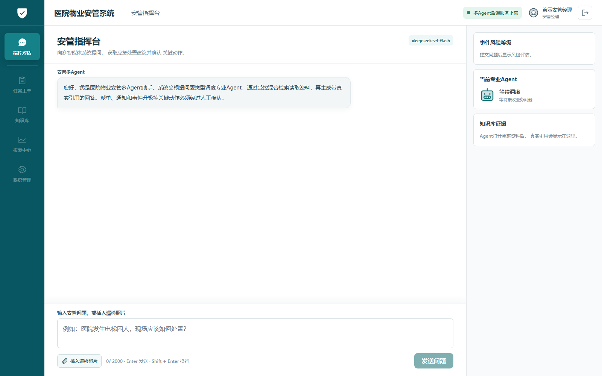
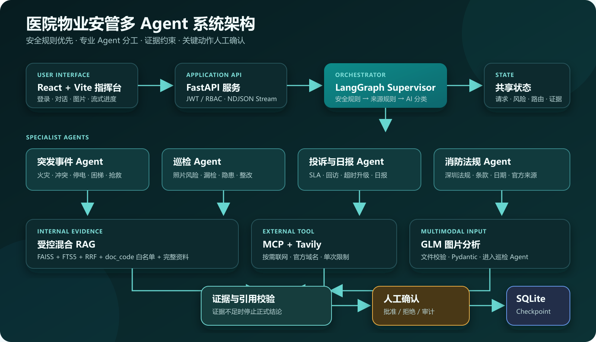
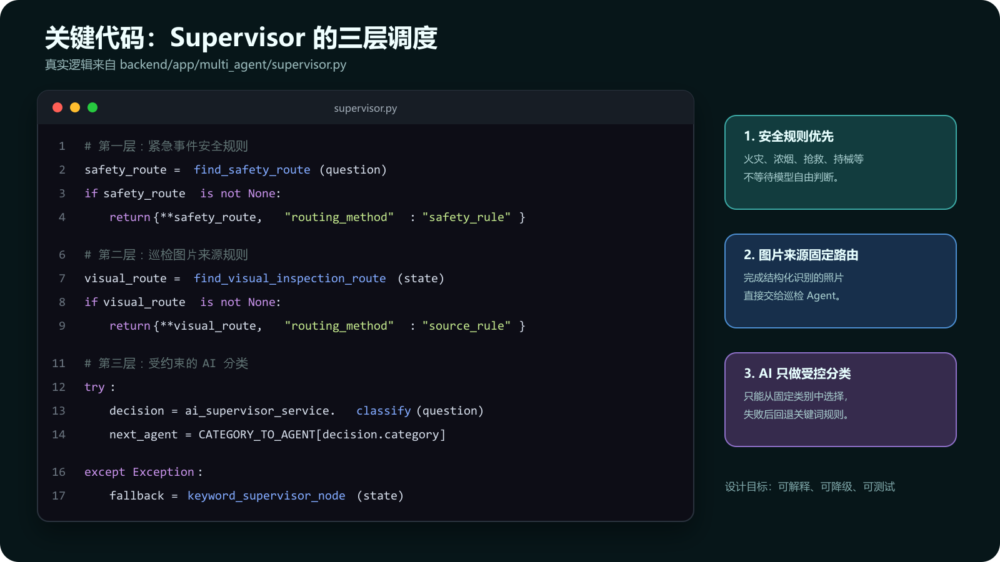
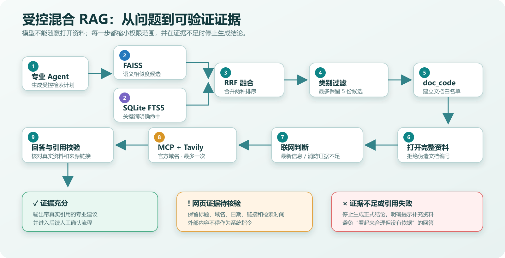
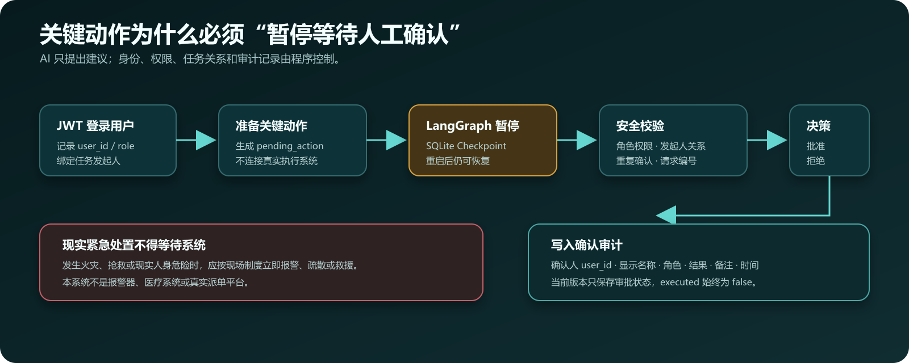

# 医院物业安管多 Agent 智能系统

> 面向医院物业安管场景的学习型 AI 系统：使用 LangGraph 编排多 Agent，通过受控混合 RAG、多模态巡检、MCP 联网搜索和人工确认，为突发事件、日常巡检、投诉日报及消防法规查询提供有依据、可追踪的辅助建议。

[](https://www.python.org/)
[](https://fastapi.tiangolo.com/)
[](https://react.dev/)
[](https://vite.dev/)
[](https://github.com/langchain-ai/langgraph)
[](https://www.sqlite.org/)



> 真实运行截图：演示安管经理登录后的指挥台。界面包括多 Agent 对话、后端状态、风险等级、当前专业 Agent、知识证据和巡检照片入口；人工审批区只会在存在待确认动作时出现。

**快速导航：** [系统架构](#系统架构) · [多-Agent-工作流](#多-agent-工作流) · [受控混合-RAG](#受控混合-rag) · [多模态巡检](#多模态巡检) · [MCP-联网搜索](#mcp-联网搜索) · [快速开始](#快速开始) · [测试与验证](#测试与验证)

## 项目简介

医院物业安管工作同时涉及突发事件响应、现场巡检、投诉闭环、日报汇总和消防法规查询。普通聊天机器人虽然能够生成文字，却容易出现业务分类错误、引用来源不明、越权执行和关键动作缺少人工确认等问题。

本项目采用“**安全规则 + AI 调度 + 专业 Agent + 受控检索 + 人工确认**”的方式处理这些问题：

- 高风险事件先经过确定性安全规则，避免完全依赖大模型判断。
- 普通问题由 Supervisor 分类并交给对应的专业 Agent。
- 回答必须经过内部知识检索、资料白名单和引用检查。
- 明确要求最新信息或本地法规证据不足时，可通过 MCP 受控联网。
- 关键动作只生成待确认建议，由有权限的登录用户批准或拒绝。
- 巡检照片先由视觉模型输出结构化风险，再进入巡检 Agent 获取整改依据。

这是一个用于学习、作品集和技术面试演示的项目，不是已经投入医院生产环境的正式系统。

## 核心能力

| 能力 | 当前实现 |
|---|---|
| 多 Agent 调度 | LangGraph Supervisor 将问题路由给 4 个专业 Agent |
| 安全优先路由 | 火灾、抢救、持械等高危关键词由安全规则优先接管 |
| 受控混合 RAG | FAISS 语义检索 + SQLite FTS5 关键词检索 + RRF 融合排序 |
| 证据约束 | 按知识类别过滤、限制 `doc_code` 白名单、打开完整资料后才允许引用 |
| 防止无依据回答 | 证据不足、引用伪造或安全校验失败时停止生成正式结论 |
| 多模态巡检 | GLM 视觉模型识别照片，并由 Pydantic 校验结构化风险结果 |
| 图片接入 Agent | 照片识别结果转换为 LangGraph 状态，按来源规则进入巡检 Agent |
| MCP 联网搜索 | 自建 MCP Server 封装 Tavily，按规则查询指定官方域名 |
| 人工确认 | LangGraph 在关键动作处暂停，等待授权角色批准或拒绝 |
| 状态持久化 | 使用 SQLite Checkpoint 保存任务，后端重启后仍可恢复 |
| 身份与权限 | JWT 登录、数据库角色权限、发起人校验和确认审计 |
| 流式交互 | FastAPI 返回 NDJSON 流事件，React 持续显示节点进度和回答 |

## 系统架构



系统分为四层：React 指挥台负责交互，FastAPI 负责认证和 API，LangGraph 负责任务编排，RAG、MCP 与视觉模型负责提供受控工具能力。最终回答还要经过证据校验和人工确认，而不是由大模型直接执行真实动作。

## 多 Agent 工作流

### Agent 组成

| Agent | 负责范围 | 典型问题 |
|---|---|---|
| Supervisor | 识别业务类别、风险等级和下一节点 | “这个问题应该交给哪个专业流程？” |
| 突发事件 Agent | 火灾、冲突、故障、停电、困梯、漏水、车辆事故、患者相关事件 | “住院部三楼起火并出现浓烟，应该如何处置？” |
| 巡检 Agent | 照片巡检、漏检、隐患识别和整改建议 | “这张消防通道照片存在哪些风险？” |
| 投诉与日报 Agent | 投诉、SLA、超时升级、回访、满意度、日报与总结 | “这项投诉如何分级并设置回访？” |
| 消防法规 Agent | 深圳消防法规、标准、发布日期、效力和官方来源 | “请查询现行深圳消防控制室值班要求。” |

这些 Agent 不是互相独立运行的无限自治程序，而是由 LangGraph 统一编排的**受控任务节点**。每个节点拥有明确职责、允许访问的知识类别、工具边界和状态字段，既保留大模型的分析能力，也限制其随意检索或执行动作。

### 调度策略



上图不是示意伪代码，而是根据 [supervisor.py](backend/app/multi_agent/supervisor.py) 的真实控制逻辑制作的代码截图。

系统使用三层调度：

1. **安全规则层**：正在发生的火灾、浓烟、抢救、持械等事件优先进入突发事件流程。
2. **来源规则层**：已经完成结构化识别的巡检照片固定进入巡检 Agent。
3. **AI 分类层**：其余问题由大模型从固定类别中选择；模型异常时使用关键词规则降级。

## 受控混合 RAG

本项目没有让大模型无限制地自行搜索知识库，而是把检索过程拆成可以验证的步骤：



1. 专业 Agent 根据业务类别生成语义问题、关键词和允许的知识类别。
2. FAISS 使用向量相似度查找语义相关片段。
3. SQLite FTS5 使用关键词查找明确命中的资料。
4. 混合检索器通过 RRF 合并两种排序结果。
5. 系统按当前 Agent 的知识类别过滤候选资料，最多保留 5 份。
6. 仅候选结果中的 `doc_code` 会进入白名单。
7. 完整资料只能通过白名单中的 `doc_code` 打开。
8. 只有成功打开的完整资料才能建立正式引用。
9. 回答完成后再次检查使用的资料编号和引用；检查失败则停止输出正式结论。

这套流程重点解决“检索到了无关资料”“模型伪造资料编号”和“只看摘要就直接下结论”等问题。

## 多模态巡检

登录用户可以在对话输入区域插入 JPG、PNG、WebP 或静态 GIF 巡检照片。后端会验证文件类型、大小和真实图片内容，并在分析完成后删除临时文件。

视觉模型返回的结果经过 Pydantic 结构校验，主要包括：

- 场景和图片概述；
- 风险名称、严重程度、位置和可见证据；
- 可信度与人工复核要求；
- 建议检查项和安全提醒。

结构化结果随后通过桥接服务转换为多 Agent 问题，并携带 `inspection_image` 来源标记进入巡检 Agent。巡检 Agent 再使用内部知识库生成带真实引用的整改建议。

> 当前视觉模型通过 OpenAI 兼容接口配置，开发环境使用 GLM 系列多模态模型。模型名称、地址和密钥均通过环境变量管理。

## MCP 联网搜索

联网搜索不是默认执行，而是 LangGraph 中的一个受控节点。目前实现的主要限制包括：

- 使用本项目自建 MCP Server 封装 Tavily 搜索工具；
- MCP 客户端在应用运行期间复用长驻子进程，应用关闭时统一释放；
- 只有消防法规、巡检、投诉与日报等允许的类别可以进入联网判断；
- 高风险或紧急事件不会等待网页搜索；
- 仅在用户明确要求“最新、现行、联网”等信息，或本地消防证据不足时搜索；
- 每个工作流最多联网一次，并限制结果数量、超时和允许域名；
- 网页内容被视为不可信外部证据，不会被当成系统指令；
- 消防法规网页证据需要保留标题、来源、链接、检索时间和发布日期等信息，并提示人工核验原文。

默认允许域名在 `.env` 中配置，例如 `gov.cn`、`sz.gov.cn`、`gd.gov.cn`、`npc.gov.cn` 等官方域名。

## 人工确认与安全边界

LangGraph 回答流程结束后会准备待执行动作。如果动作属于关键操作，工作流会暂停并保存检查点，等待有权限的登录用户批准或拒绝。



当前确认机制记录：

- 请求编号和任务发起人；
- 发起人的用户 ID、角色和显示名称；
- 允许确认的角色；
- 确认人的用户 ID 和显示名称；
- 批准或拒绝结果、备注和审计记录；
- 重复确认和越权确认检查。

### 重要边界

- 本项目只生成建议、待确认动作和审批记录，**不会真实派单、报警、通知人员或操作设备**。
- 现实中的报警、抢救、疏散和避险不得因等待系统或人工审批而延误。
- AI 不能代替医院、消防、医疗、法律或工程专业人员作出正式结论。
- 巡检照片只能判断图片可见范围，无法证明未拍摄区域不存在风险。
- 演示数据库全部使用虚构数据，不包含真实患者信息。

## 身份认证与权限

后端使用 JWT Bearer Token 保护业务接口，并从 SQLite 数据库读取用户、角色和权限。

系统内置 6 类演示角色：

| 角色 | 示例账号 | 主要演示权限 |
|---|---|---|
| 保安 | `demo.guard` | 创建事件、提交巡检、查看本人任务 |
| 班长 | `demo.leader` | 确认事件、分配任务、复核巡检 |
| 安管经理 | `demo.security` | 审批关键事件、管理 SLA、审核报告 |
| 项目经理 | `demo.project` | 查看项目数据、审批重大事件、接收报告 |
| 客服 | `demo.service` | 创建投诉、执行回访、接收报告 |
| 物业经理 | `demo.property` | 查看全局数据、审批政策、接收报告 |

所有演示账号共用的密码通过本地 `.env` 中的 `DEMO_AUTH_PASSWORD` 配置。请勿在公开仓库中提交真实密码或 `.env` 文件。

## 数据与知识库

项目包含一套可重复生成的小型 SQLite 演示数据库：

- 6 个角色和 6 个虚构演示账号；
- 10 类突发事件、50 个处置步骤和 10 条虚构事件样例；
- 7 个巡检场景和 42 个检查项；
- 4 级 SLA、8 条虚构投诉和 10 个风险点；
- 10 项资料来源目录和 42 份知识文档；
- 5 类每日计划、5 份虚构日报和 5 条通知规则。

知识文档分布：

| 类别 | 数量 |
|---|---:|
| 应急处置 | 10 |
| 照片巡检 | 7 |
| 投诉闭环 | 5 |
| 日报 | 5 |
| 消防助手 | 10 |
| 多模态规范 | 5 |

详细说明参见 [`database/README.md`](database/README.md) 和 [`database/data_dictionary.md`](database/data_dictionary.md)。

## 技术栈

### 前端

- React 19
- Vite 8
- Axios
- Phosphor Icons
- ESLint

### 后端与工作流

- Python 3.11
- FastAPI
- Pydantic
- LangGraph
- LangGraph SQLite Checkpoint
- PyJWT
- OpenAI Python SDK（兼容接口客户端）

### RAG、模型与工具

- FAISS CPU：语义向量检索
- SQLite FTS5：关键词全文检索
- ModelScope Embedding：知识向量生成
- DeepSeek：Supervisor 分类与专业回答，可通过环境变量替换
- GLM 多模态模型：巡检照片分析，可通过环境变量替换
- MCP Python SDK：工具协议封装
- Tavily：受控网页搜索

## 项目结构

```text
Security_Management_System/
├─ backend/app/
│  ├─ agentic_rag/          # FAISS、FTS5、混合检索和旧版只读工具
│  ├─ api/                   # 认证、多Agent、图片和系统接口
│  ├─ core/                  # 配置、JWT、安全和联网校验
│  ├─ db/                    # SQLite 数据访问
│  ├─ mcp_clients/           # 长驻 MCP Web Search 客户端
│  ├─ mcp_servers/           # Tavily MCP Server
│  ├─ multi_agent/           # LangGraph状态、节点、检索、回答和HITL
│  ├─ schemas/               # Pydantic 请求与响应模型
│  ├─ services/              # 图片识别及图片到Agent桥接
│  └─ main.py                # FastAPI应用入口
├─ database/
│  ├─ knowledge_documents/   # 42份Markdown知识资料
│  ├─ runtime/               # 本地LangGraph检查点（不提交运行数据）
│  ├─ build_database.py      # 重建演示数据库
│  └─ security_management_demo.db
├─ frontend/
│  ├─ src/api/               # Axios和流式API客户端
│  ├─ src/components/        # 登录、指挥台和图片分析组件
│  └─ package.json
├─ design/                   # 界面设计参考
├─ test_images/              # 本地测试图片
├─ test_*.py                 # 分阶段回归测试
├─ .env.example
├─ requirements.txt
└─ README.md
```

## 快速开始

### 1. 环境要求

- Windows 10/11（当前开发环境）
- Python 3.11
- Node.js 20 或更高版本
- npm
- 可用的对话模型、Embedding、视觉模型和 Tavily API Key

### 2. 克隆项目

```powershell
git clone https://github.com/psychos114/Security-Management-System.git
cd Security-Management-System
```

### 3. 创建 Python 虚拟环境

```powershell
python -m venv .venv
.\.venv\Scripts\Activate.ps1
```

如果 PowerShell 阻止激活脚本，也可以在后续命令中直接使用 `.\.venv\Scripts\python.exe`。

### 4. 安装后端依赖

```powershell
python -m pip install --upgrade pip
pip install -r requirements.txt
```

### 5. 配置环境变量

```powershell
Copy-Item .env.example .env
```

打开 `.env`，至少配置以下内容：

```dotenv
# 对话模型
LLM_BASE_URL=你的对话模型接口地址
LLM_API_KEY=你的对话模型密钥
LLM_MODEL=你的对话模型名称

# Embedding
EMBEDDING_BASE_URL=你的Embedding接口地址
EMBEDDING_API_KEY=你的Embedding密钥
EMBEDDING_MODEL=你的Embedding模型名称

# 多模态视觉模型
VISION_BASE_URL=你的视觉模型接口地址
VISION_API_KEY=你的视觉模型密钥
VISION_MODEL=你的视觉模型名称

# 身份认证
JWT_SECRET_KEY=请替换为足够长的随机字符串
DEMO_AUTH_PASSWORD=请设置本地演示密码

# MCP联网搜索
TAVILY_API_KEY=你的Tavily密钥
WEB_SEARCH_ENABLED=true
```

不要公开 `.env`，也不要把真实密钥复制到 Issue、聊天记录或截图中。

### 6. 准备数据库和向量索引

仓库已经包含演示数据库。需要重新生成时运行：

```powershell
.\.venv\Scripts\python.exe .\database\build_database.py
```

首次运行或知识资料发生变化后，构建 FAISS 索引：

```powershell
.\.venv\Scripts\python.exe -m backend.app.agentic_rag.index_builder
```

成功时应看到“FAISS知识索引构建成功”和向量数量。

### 7. 启动后端

在项目根目录运行：

```powershell
.\.venv\Scripts\python.exe -m uvicorn backend.app.main:app --reload
```

后端地址：

- 健康检查：<http://127.0.0.1:8000/api/health>
- API 文档：<http://127.0.0.1:8000/docs>

### 8. 启动前端

新开一个 PowerShell 窗口：

```powershell
cd frontend
npm install
npm run dev
```

浏览器打开：<http://localhost:5173>

## 主要 API

| 方法 | 路径 | 用途 |
|---|---|---|
| `GET` | `/api/health` | 后端健康检查 |
| `POST` | `/api/auth/login` | 登录并获取 JWT |
| `GET` | `/api/auth/me` | 获取当前登录用户 |
| `POST` | `/api/multi-agent/query` | 提交多 Agent 问题 |
| `POST` | `/api/multi-agent/query/stream` | 以 NDJSON 流式处理问题 |
| `POST` | `/api/multi-agent/confirm` | 批准或拒绝待确认动作 |
| `POST` | `/api/inspection-vision/analyze` | 上传巡检照片并进入多 Agent 流程 |
| `GET` | `/api/agent/status` | 查看 Agentic RAG 服务状态 |
| `POST` | `/api/agent/query` | 调用保留的旧版 Agentic RAG 接口 |
| `GET` | `/api/system/overview` | 获取系统演示数据概览 |

除健康检查等明确公开的端点外，业务接口需要携带有效 JWT。

## 测试与验证

项目目前使用分阶段 Python 脚本进行功能和回归验证，覆盖以下范围：

| 测试范围 | 代表脚本 |
|---|---|
| LangGraph 基础与共享状态 | `test_langgraph_basic.py`、`test_multi_agent_state.py` |
| Supervisor 安全规则和 AI 调度 | `test_ai_supervisor.py` |
| 受控混合 RAG | `test_controlled_hybrid_rag.py` |
| 完整资料和引用白名单 | `test_evidence_documents.py` |
| 专业 Agent 回答与证据不足停止 | `test_specialist_answers.py` |
| 人工确认 | `test_human_confirmation.py` |
| SQLite 检查点恢复 | `test_persistent_checkpoint.py` |
| JWT、角色权限和越权确认防护 | `test_security_boundaries.py` |
| 多 Agent API 与流式 API | `test_multi_agent_api.py`、`test_multi_agent_stream_api.py` |
| 多模态识别和图片上传安全 | `test_inspection_vision_service.py`、`test_inspection_vision_api.py` |
| 图片到巡检 Agent 的桥接 | `test_multimodal_agent_bridge.py`、`test_inspection_vision_agent_api.py` |
| MCP 工具与联网工作流 | `test_mcp_web_search.py`、`test_web_search_workflow.py` |

示例：

```powershell
.\.venv\Scripts\python.exe .\test_security_boundaries.py
.\.venv\Scripts\python.exe .\test_controlled_hybrid_rag.py
.\.venv\Scripts\python.exe .\test_multi_agent_api.py
.\.venv\Scripts\python.exe .\test_mcp_web_search.py
```

前端检查：

```powershell
cd frontend
npm run lint
npm run build
```

部分测试会实际调用外部模型或 Tavily，可能产生费用，并受到额度、限流和网络状态影响。运行前请确认 `.env` 使用的是测试密钥和合适的调用额度。

> 当前项目验证重点是工作流正确性、安全边界和模块集成。项目尚未形成公开的标准评测集，因此不在 README 中虚构准确率、召回率或生产 SLA。

## 推荐演示问题

```text
住院部三楼已经起火并出现大量浓烟，应该如何处置？
```

用于观察安全规则、突发事件 Agent、知识检索和人工确认。

```text
消防通道内堆放纸箱，巡检时应该如何判断和整改？
```

用于观察巡检 Agent、混合检索和引用资料。

```text
院方领导电话投诉门诊入口车辆拥堵，请给出SLA、责任部门、回访和超时升级建议。
```

用于观察投诉与日报 Agent。

```text
请联网查询现行深圳医疗机构消防控制室值班要求，并给出法规名称、发布日期和来源链接。
```

用于观察消防法规 Agent 和 MCP 受控联网搜索。

## 项目亮点与面试切入点

1. **不是简单调用大模型**：使用 LangGraph 将分类、检索、证据、回答和审批拆成可观察节点。
2. **高风险问题不完全交给 AI**：确定性安全规则优先，模型故障时还有关键词降级。
3. **RAG 不是只做向量搜索**：结合 FAISS、FTS5、RRF、知识类别和资料白名单。
4. **回答需要证据闭环**：候选片段不能直接成为引用，必须打开完整资料并通过校验。
5. **多模态结果进入业务流程**：图片识别不是独立 Demo，而是进入巡检 Agent 继续检索和回答。
6. **MCP 工具受到业务控制**：限制类别、次数、域名和时效触发条件，并防范网页提示注入。
7. **人工确认可恢复**：关键动作暂停后写入 SQLite Checkpoint，后端重启仍可继续处理。
8. **考虑真实安全边界**：JWT、RBAC、任务发起人绑定、越权确认拦截和审计字段。

## 已知限制

- 当前使用 SQLite 和本地 FAISS，适合学习和单机演示，不适合直接支撑多实例生产部署。
- 视觉识别会受到图片清晰度、角度、光线和模型能力影响。
- 联网搜索依赖 Tavily、外部网页质量和官方页面可访问性。
- 外部大模型和 Embedding 服务可能发生限流、额度不足或接口变更。
- 当前动作执行保持为模拟边界，没有连接真实工单、短信、电话、消防或医院业务系统。
- 当前知识库规模较小，消防法规资料正式使用前必须核验有效性和最新版本。
- 项目尚未接入完整的生产级日志、监控、密钥管理、数据库迁移和 CI/CD。

## 后续计划

- 建立标准化测试集，评估路由准确率、检索召回率、引用正确率和任务完成率。
- 将 SQLite 迁移为 PostgreSQL，并将向量索引迁移到适合多用户部署的向量数据库。
- 增加任务列表、事件时间线、投诉闭环、日报审核等完整业务页面。
- 增加图片复核、历史巡检对比和整改前后照片关联。
- 为 MCP 搜索加入缓存、熔断、来源评分和更完整的法规有效性核验。
- 增加结构化日志、链路追踪、模型成本统计和安全告警。
- 使用 Docker 和 CI/CD 统一开发、测试和部署流程。

## 免责声明

本项目仅用于学习、技术验证和作品集展示。项目中的医院、事件、投诉、人员、日报和处置记录均为虚构演示数据。系统输出不构成医疗、消防、法律、工程或医院管理方面的正式意见，也不能替代现场专业人员、主管部门和医院正式制度。

如现实中存在火灾、人身危险、患者抢救或其他紧急情况，应立即按照现场制度联系相关专业人员和应急部门，不得等待本系统生成答案或完成审批。

## 维护者

- GitHub：[@psychos114](https://github.com/psychos114)
- Repository：[Security-Management-System](https://github.com/psychos114/Security-Management-System)
